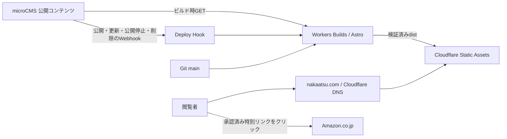

# Cloudflare・Astro移行計画

作成日・料金／仕様確認日: 2026-10-12  
前提: Next.js＋Vercelから移行し、microCMS、Amazonアソシエイト、既存ドメインnakaatsu.comを継続する。「AstoJs」はAstroとして扱う。  
関連文書: [現行プロジェクト調査](./project-review-2026-10-12.md)

## 1. 推奨構成

**Astroの静的生成＋Cloudflare Workers Static Assets＋Workers Builds＋microCMSのWebhookを採用する。Honoは初期移行では使わず、必要なAPIに後から追加する。**

現行実装も静的出力であり、会員機能や閲覧ごとの動的処理は確認されていない。ブログ・レビュー・ポートフォリオは、ビルド済みHTMLを配信する構成が費用・速度・保守性に適する。Amazonのリンク掲載自体にSSRは必要ない。

Astroは静的構成ならCloudflareアダプターが不要。Cloudflareは新規プロジェクトにWorkersを推奨している。Workers Static AssetsはWorkerスクリプトなしでも配信できるため、「Workersを選ぶ＝全閲覧で有料の計算処理」という意味ではない。[AstroのCloudflareガイド](https://docs.astro.build/en/guides/deploy/cloudflare/)、[アダプターの適用範囲](https://docs.astro.build/en/guides/integrations-guide/cloudflare/)



CMSのAPIキーはビルド環境だけに保存する。訪問者からCMSへ直接アクセスさせない。公開停止・削除後の古いページは、再ビルド成功まで残るため、更新検知と反映監視も移行対象にする。

## 2. 選択肢の比較

以下の適合性評価は、現行コードとサイト用途からの判断。

| 選択肢                           | 適合性             | 利点                                                              | 主な負担／採用条件                                             |
| -------------------------------- | ------------------ | ----------------------------------------------------------------- | -------------------------------------------------------------- |
| Astro SSG＋Workers Static Assets | 推奨               | コンテンツ用テンプレート、少ないJS、無料の静的配信、将来のAPI追加 | CMS更新の再ビルド、DNS移行が必要                               |
| Astro SSG＋Cloudflare Pages      | 有力な代替         | 静的配信無料、microCMSに専用Webhook設定あり                       | Freeは月500ビルド。今回の新規移行ではWorkersを優先             |
| Hono＋Workers SSR                | 初期移行には非推奨 | API・認証・動的ルーティングに向く                                 | CMS取得とキャッシュ、SEO、HTML・画像・ビルド構成を設計する必要 |
| Astro SSG＋必要部分だけHono      | 将来の拡張         | 静的サイトを維持して限定APIを追加                                 | APIが実際に必要になった段階で導入                              |

Honoでも静的サイトやSSGツールとの組み合わせは可能であり、必ずSSRになるわけではない。ただし、今回必要なのは記事サイトの静的生成なのでAstroを主役にする。[HonoのWorkersガイド](https://hono.dev/docs/getting-started/cloudflare-workers)

Pagesの代替構成を選ぶ条件は、Workers Buildsの接続・Webhookの実証が難しい場合、または運用者がPagesの編集体験を優先する場合。両方を並行運用する必要はない。[Pagesの料金](https://developers.cloudflare.com/pages/functions/pricing/)、[Pagesの制限](https://developers.cloudflare.com/pages/platform/limits/)

## 3. 費用の見込みと無料枠

### 初期構成の予算

| 項目                     | 見込み                                  | 条件                                                                     |
| ------------------------ | --------------------------------------- | ------------------------------------------------------------------------ |
| Cloudflare Static Assets | $0/月                                   | 静的アセットへのリクエストは無料・無制限。Workerスクリプトを経由させない |
| Workers Builds           | $0/月の範囲を目標                       | Free: 月3,000ビルド分、同時1件、1回20分まで                              |
| microCMS                 | 現契約を継続。Hobby条件に収まれば0円/月 | HobbyはAPI呼び出し無制限、転送量20GB/月。超過時API停止                   |
| ドメイン                 | 現レジストラの更新料                    | DNS変更だけではドメイン更新料は消えない                                  |
| 解析・画像・追加API      | 初期は新規固定費を追加しない            | 既存利用と必要機能を確認して選ぶ                                         |

静的配信とWorker実行の料金は別。`run_worker_first` を全URLに設定したり、Worker経由のキャッシュ機能を使うと、静的ファイルがあっても実行・リクエストの料金体系が変わり得る。初期はスクリプトなしのStatic Assets配信にする。[静的配信の料金](https://developers.cloudflare.com/workers/static-assets/billing-and-limitations/)

Workers Freeの動的処理は1日100,000リクエスト、CPU 10ms/呼び出し。将来Paidを使う場合はアカウント単位で月$5から。無料上限の超過を自動的な有料継続と考えない。Cloudflare Proへの加入を初期構成の前提にしない。[Workers料金](https://developers.cloudflare.com/workers/platform/pricing/)

ビルド分はコード更新、CMS更新、再試行、プレビューも含めて集計する。仮に月100回×3分なら300分、月500回×5分なら2,500分。後者は余裕が少なく、実測が必要。使用量が無料枠の70%を超えたら更新まとめ・ビルド時間短縮を検討し、90%で追加変更の運用を見直す。これは運用目標でありCloudflareの自動通知設定の保証ではない。[Buildsの制限・料金](https://developers.cloudflare.com/workers/ci-cd/builds/limits-and-pricing/)

microCMSの上限評価はJSON取得だけではなく、契約上の転送量集計対象も管理画面で確認する。ブラウザーが読むmicroCMS画像もコスト評価から除外しない。Hobbyへ変更する前にメンバー・API数・必要機能・最新利用条件を確認する。[microCMS料金](https://microcms.io/pricing)

現Vercel料金・PV・CMS契約は未確認なので、削減額は未確定。現在も無料なら月額削減は0円であり、移行の価値は将来の費用と保守負担を抑えることになる。月間純収益は「確定紹介料－ホスティング－CMS－ドメイン月割り－その他サービス費」で記録する。

## 4. Amazonアソシエイトの収益化設計

### 初期公開

- 既存アカウント、承認状態、登録サイト、トラッキングIDを確認する。同一ドメインのホスティング変更だけを理由に新規アカウントを作らない。正規ホスト変更や追加サイトがある場合は登録情報を照合する。
- Amazonが提供する作成ツールで生成した特別リンクを使う。既存リンクのtag等を移行で落とさない。外部遷移は通常のa要素で直接行い、独自の `/go/*` リダイレクトやリンク隠蔽は初期に導入しない。
- 共通フッター等に「Amazonのアソシエイトとして、nakaatsuは適格販売により収入を得ています。」を目立つように表示する。広告を含む記事にも冒頭の開示を置く。現行ポリシーの単なる参加表記だけで十分と決めつけない。[Amazon運営規約](https://affiliate.amazon.co.jp/help/operating/agreement)
- カードには独自の商品紹介・実体験・自前の権利確認済み写真を使い、Amazonの価格・在庫・評価・商品画像をスクレイピングして掲載しない。初期は価格を固定表示せず「Amazonで確認する」とする。[Amazonプログラムポリシー](https://affiliate.amazon.co.jp/help/operating/policies/)
- 商品リンクには `rel="sponsored noopener"` を基本として付ける。これは実装上のSEO・安全性方針であり、Amazonが指定する唯一の必須属性という意味ではない。
- 公開プレビューはnoindex、広告クリック計測は無効にする。検証はURL・tag・遷移先・表示を確認し、自己購入で成果を作らない。

既存アカウントで未承認なら、その状態に応じて審査条件を確認する。新規申請については180日以内の3件の適格販売が案内されているが、既存承認済みアカウントの移行で審査期限が再開するという意味ではない。[Amazon審査ヘルプ](https://affiliate.amazon.co.jp/help/node/topic/G7MJTPEP9NC3YKMG)、[サイト登録ヘルプ](https://affiliate.amazon.co.jp/help/node/topic/GM3CX5D6DSLGVSJD)

### microCMSの管理項目

既存blogsの本文とIDを維持し、必要に応じて記事に商品紹介の繰り返しフィールドを追加する。初期は新しいAPIを増やさず運用できる設計を優先する。

| 項目案         | 用途                                 |
| -------------- | ------------------------------------ |
| displayName    | 独自の商品名表示                     |
| affiliateUrl   | Amazon提供ツールで作成した特別リンク |
| ownImage       | 自前または利用権を確認した画像       |
| recommendation | 実体験・選定理由・向かない用途       |
| asin（任意）   | 商品識別、将来のAPI連携              |
| lastReviewedAt | リンクと記事を再確認した日           |

URLはビルド時にHTTPSと許可ホストを検証し、文字列のincludesではなくURLを解析する。Amazon公式の短縮リンクを許可する場合も明示的に許可リストに含める。タグ確認は短縮URLの展開結果も考慮する。CMSフィールド名は案であり、実スキーマは未変更。

### 計測とコンテンツ

既存の趣味領域から、実際に使用したガジェット・水槽用品・植物用品などの記事を優先する。移行と同時に大量の自動商品ページを作らない。記事は用途、使用期間、メリット、制約、比較、向く人を含める。

既存GTMを継続するなら重複タグを整理し、クリックイベントに記事ID・掲載位置・商品IDを付ける。Amazonへの直接遷移を待たせない。Cookie・外部送信などの実際の挙動に合わせてポリシーを更新する。クリック数とAmazonの確定成果は別々に集計する。収益の保証はできないため、初月は表示速度・流入維持・計測の正確性を評価し、その後に記事改善を進める。

### 商品APIは後続フェーズ

初期のリンク収益化に商品APIは不要。必要になった場合はCreators APIを調査する。旧PA-APIの新規実装を計画の前提にしない。公式旧ドキュメントには2026-05-15の非推奨化が案内されている。[Creators API](https://affiliate.amazon.co.jp/creatorsapi/docs/en-us/introduction)、[PA-APIの案内](https://webservices.amazon.co.jp/paapi5/documentation/register-for-pa-api.html)

商品データ取得が必要になった時点で、利用資格・日本向け提供条件・表示／キャッシュ／画像／鮮度条件を確認する。長期間固定されるSSG HTMLへの価格埋め込みは採用前に条件を検証する。必要な部分だけHono Workerで取得・更新し、キーと認証情報はSecretsへ保存する。公開APIを無制限な商品取得プロキシにしない。

## 5. Astroへの実装移行

既存Gitリポジトリの移行ブランチで作業し、本番Next.jsは切り替えまで稼働させる。既存CMSのコンテンツID・公開日時・カテゴリ・画像URLを維持する。CMSサービスを新規作成して記事をコピーすることは初期の必須作業にしない。

| 現在の実装                         | 移行先                                          |
| ---------------------------------- | ----------------------------------------------- |
| app/layout.tsx、Navigation、Footer | Astro Layoutと静的部品                          |
| 各page.tsx                         | src/pagesの.astroページ                         |
| 記事generateStaticParams           | Astro getStaticPathsによる既存IDの全件生成      |
| microCMS取得関数                   | ビルド専用の型付き取得・検証処理                |
| html-react-parser                  | ビルド時サニタイズ済みHTMLの出力                |
| next/image                         | ローカル画像のAstro最適化、CMS画像のサイズ別URL |
| CardHeader、TopBlogs、Works        | 原則.astro化、共通カード部品                    |
| ブログのカテゴリ操作               | 静的カテゴリURL＋必要最小限のJS                 |
| Framer Motion、ProgressBar         | CSS／小さなJSへ置換。必要箇所だけisland         |
| metadata、sitemap                  | 共通SEO部品と公開URL一覧から生成                |

Astro移行時にReactを全面的に残すとJS削減の効果が弱くなる。移植に必要な部品だけReact islandとして一時維持し、全ページをclient:loadにしない。CSS Modulesは見た目を保ちながら移植し、不要CSSと重複依存を段階的に削る。

CMS取得は一覧・詳細・sitemapで共有できるビルド用スナップショットにまとめる。必要なフィールドだけ取得し、レスポンスの必須値を検証する。タイムアウトと上限付き再試行を設定し、部分取得を成功扱いしない。CMSが更新中の場合の整合性は件数・ID照合と実証で確認する。

### URL方針

| URL                                      | 方針                               |
| ---------------------------------------- | ---------------------------------- |
| /、/profile、/privacyPolicy              | 維持                               |
| /blog/{既存ID}                           | 維持。slugへの置換は同時に行わない |
| /blog                                    | 全件一覧の1ページ目                |
| /blog/page/1                             | /blogへ301                         |
| /blog/page/{2以上}                       | 維持、範囲外は404                  |
| /blog/category/{categoryId}              | 新規静的カテゴリ一覧               |
| /blog/category/{categoryId}/page/{2以上} | 必要分だけ静的生成                 |
| 不明なURL                                | 本物の404ステータス＋404ページ     |

カテゴリ選択はURL遷移にする。JSなしでも機能し、再読み込みと共有で状態が揃う。旧URLに変更が必要な場合だけ1対1の301一覧を作る。任意の不明URLをトップページに200で返すSPA fallbackは使わない。

正規ホストは、現行VercelのリダイレクトとSearch Consoleを調べてから決める。コードにwww有無の混在があるため、現段階でどちらが本番の正規ホストかは断定しない。既存の正規ホストを維持し、反対側からパス・クエリを保った301を設定する。

### 配信設定案

Astroは `output: 'static'`、`trailingSlash: 'never'` を基本に、正規ホストをsiteへ指定する。下記は計画用の雛形で、リポジトリに実設定を導入したものではない。

```jsonc
{
  "name": "nakaatsu-site",
  "compatibility_date": "2026-10-12",
  "assets": {
    "directory": "./dist",
    "html_handling": "drop-trailing-slash",
    "not_found_handling": "404-page",
  },
}
```

本番はCustom Domainを接続する。Workers側のHTML処理とAstroの出力形式が一致することを実測する。Astroに404ページを作り、distの404.htmlを確認する。[SSGと404](https://developers.cloudflare.com/workers/static-assets/routing/static-site-generation/)

`public/_headers` でCSP、nosniff、Referrer-Policy等を設定し、埋め込み・計測に必要な許可先を実データから決める。CSPは検証環境で調整してから強制する。フォントは可能ならビルド時取得／自前配信にし、外部読み込みを減らす。[Static Assetsのヘッダー](https://developers.cloudflare.com/workers/static-assets/headers/)

パス変更は `public/_redirects` で扱い、ホスト全体の転送はCloudflareのRedirect Rules等で扱う。`_redirects` にドメイン全体の転送が実装できると仮定しない。[Static Assetsのリダイレクト](https://developers.cloudflare.com/workers/static-assets/redirects/)

## 6. CMS更新とCI/CD

Git接続したWorkers Buildsに、本番main用Deploy Hookを作る。microCMSのカスタムWebhookからHTTP POSTする。Workers Buildsには現在Deploy Hooksがあり、Pages専用機能ではない。[Workers Deploy Hooks](https://developers.cloudflare.com/workers/ci-cd/builds/deploy-hooks/)

1. コード更新: PRで静的解析・型・重点テストを行い、mainのビルド成功後に配信する。
2. CMS更新: 公開・公開中更新・公開停止・削除を対象にHookを設定する。下書き保存は本番ビルドの対象にしない。
3. ビルド: CMS取得、HTMLサニタイズ、全公開ページ生成、URL・件数・リンク・秘密情報混入の検証を行う。
4. デプロイ: 検証が通ったdistだけを配信。取得失敗や検証失敗時は終了コードを失敗にし、旧正常デプロイを維持する。
5. 反映確認: 公開記事のタイトル・更新日時、削除URLの404、sitemapを確認し、公開から5分以内の反映を初期目標とする。実測で目標を調整する。

Hook URL自体が認証情報なので、Git・公開HTML・ログに保存しない。漏洩時は再発行する。直結の場合はmicroCMS署名の検証用受信処理を設けない構成であることを理解する。まず公開イベントだけに絞り、短期間の大量更新と更新中の再ビルドを実証する。重複ビルドや順序の問題が発生した場合は、Honoによる署名検証・イベント統合と、必要な永続ストレージを追加する。初期からKV／D1／Queuesを全て導入しない。[microCMS Webhook](https://document.microcms.io/manual/webhook-setting)

Secretsは本番ビルドへだけ渡し、未信頼の外部PRには渡さない。CMSプレビューが必要なら、別の保護された環境と認証で実装し、draftKey付きHTML・JSONを公開distへ含めない。初期は公開済みコンテンツのプレビューだけを必須とする。

## 7. ドメイン・DNS移行とSEO維持

ドメイン名は変更しない。レジストラ移管は必須ではなく、今回のサイト移行と分ける。Cloudflare DNSへネームサーバーを変更しても、ドメインの契約先は維持できる。Workers Custom DomainにはactiveなCloudflare zoneが必要で、既存CNAMEとの衝突に注意する。[Custom Domains](https://developers.cloudflare.com/workers/configuration/routing/custom-domains/)

### DNS移行を先に分離する

1. 現DNSのA／AAAA／CNAME／MX／TXT／CAA、サブドメイン、メール設定、検証レコード、DNSSECのDSを控える。Vercelの現設定と復旧用デプロイも保存する。
2. Cloudflare zoneにレコードを照合して登録し、Webの参照先はVercelのままにする。MX・メールホストをWeb配信へ向けない。
3. DNSSECが有効ならレジストラとCloudflareの手順に従ってDSを整合させる。古いDSを残したままネームサーバーを切り替えない。
4. 可能なら事前にTTLを短縮し、旧TTL期間を考慮してからネームサーバーを変更する。伝播時間は固定保証しない。
5. DNS移行のみでWeb・メール・SSL・Vercel検証が正常であることを確認する。

### サイトの切り替え

1. Cloudflareの検証URLで全URL・アセット・リンク・404を確認する。プレビューにはnoindexを設定する。
2. 切り替え直前に最新CMS内容を再取得し、本番distを生成する。
3. 既存Webレコードと競合する設定だけを整理し、本番Custom DomainをStatic Assetsに接続する。www有無のもう一方も受け口と301を用意する。
4. apex／www、HTTP／HTTPS、パスとクエリ、証明書、メールを確認する。Custom DomainはDNSも管理するため、既存CNAMEの削除・復旧手順を事前に用意する。
5. 本番noindexを外し、canonical・OG・sitemap・robotsを検査する。Googlebotを一律にチャレンジするWAF設定を避ける。
6. Search Consoleの既存プロパティを維持し、sitemapを再送信する。同一ホスト／URLのホスティング移行でアドレス変更を申請する必要はない。正規ホストも変更する場合は別のURL移行として評価する。

旧サイトからのURL一覧、CMSの全公開ID、sitemapを照合し、保持・301・404の各期待値を一覧化する。記事名や投稿日・本文を同時に大幅変更せず、技術移行とSEO上の内容変更を分ける。

## 8. 作業フェーズと成果物

期間は1名で既存見た目を概ね維持する場合の目安。実記事数、埋め込み、プレビュー要件で増減する。

| フェーズ          | 目安          | 作業・成果物                                        | 完了条件                             |
| ----------------- | ------------- | --------------------------------------------------- | ------------------------------------ |
| 0: 現状計測       | 0.5〜1日      | 契約・PV・DNS・URL・CMS・Amazon登録・速度の棚卸し   | 費用基準と旧URL一覧、復旧設定がある  |
| 1: 小さな実証     | 1日           | Astroで記事数本、CMS取得、Static Assets、Hook       | 公開・更新・削除の反映を確認         |
| 2: 全ページ移植   | 3〜5日        | Layout、一覧、カテゴリ、詳細、profile、policy、画像 | 全公開記事と既存URLを生成            |
| 3: 安全性・収益化 | 1〜2日        | サニタイズ、SEO、開示、カード、クリック計測         | 危険HTML除去とリンク・計測を確認     |
| 4: 切り替え準備   | 1日           | CI、件数検証、DNS移行、全URLテスト                  | 受け入れチェックが全て通る           |
| 5: 本番切り替え   | 0.5日＋監視   | Custom Domain接続、SSL、301、SEO検証                | 本番で主要機能と更新が正常           |
| 6: 安定化・整理   | 7〜14日の観測 | 流入・404・課金・更新確認、旧環境整理               | Vercelを戻し先として不要と判断できる |

実装は概ね8〜11営業日を予算化する。DNSの伝播と観測期間は別。課金変更、DNS切り替え、Vercel停止はこの計画書作成では実施していない。

## 9. 受け入れチェック

- [ ] 既存公開記事のID・URL・本文・公開日・画像が一致する。
- [ ] 通常記事、画像なし、カテゴリなし、長いタイトル、表、コード、埋め込みを確認した。
- [ ] URLごとの200／301／404を全件検証し、リダイレクトループがない。
- [ ] カテゴリ・ページ・戻る／進む・共有・再読み込みで内容が一致する。
- [ ] JSなしでも本文・商品リンク・カテゴリ移動が機能する。
- [ ] モバイル表示、キーボード操作、名前付きリンク、reduced-motionを確認した。
- [ ] APIキー・draftKey・Hook URL・未公開記事がdistへ混入していない。
- [ ] 危険HTMLの除去、CSP、正常な埋め込みを確認した。
- [ ] Amazonリンクのtag・遷移先・開示・登録サイトを確認した。
- [ ] 検証環境のnoindexと、本番のindex可能状態が正しい。
- [ ] CMS公開／更新／停止／削除を試し、失敗時の旧版維持と再実行を確認した。
- CMS更新がビルド中に重なる実地試験は依頼者の判断で省略。取得中の更新検知は単体テストで確認済み。
- [ ] sitemap・canonical・OG・robots・画像の代替表示が正しい。
- [ ] apex／www／SSL／メール／DNSSECに異常がない。
- [ ] 同じ条件で移行前後の速度と転送量を比較した。初期目標はモバイルLCP 2.5秒以内、CLS 0.1以下。実ユーザー値は観測期間を取る。
- [ ] ビルド分・CMS転送量・追加サービス費が予算内である。
- [ ] 復旧手順を実行可能な形で控え、担当者が確認した。

## 10. ロールバックと旧環境の終了

重大な記事欠落、秘密情報混入、主要URLの5xx、SSL不良、Amazonリンクのタグ欠落などは切り戻し対象。単発の検証失敗なら直近正常なStatic Assetsデプロイへ戻す。移行そのものの問題ならVercelへ戻す。

Vercelへ戻す場合は、CloudflareのCustom Domain／競合ルートを解除し、保存したVercel用A／CNAME等をCloudflare DNSに復元する。www転送も旧方針へ戻す。Cloudflare DNSは維持し、ネームサーバーを再変更することを通常の復旧手順にしない。TTL・証明書・Vercelのドメイン登録を含めて復旧を確認する。CMSのバックアップだけでは配信先の復旧にならない。

CMSスキーマは初期に破壊的変更をせず、旧サイトからも読める状態を保つ。Vercelのプロジェクト・ドメイン設定・復旧可能なデプロイは7〜14日の観測期間中保持する。正常な更新・流入・費用を確認してから旧Webhookを止め、不要なキー・トークンを失効し、Vercelの有料枠が他プロジェクトに必要か確認して解約／縮小する。

## 11. 実装前に確定する情報

| 未確認項目                                 | 計画への影響               |
| ------------------------------------------ | -------------------------- |
| 現Vercel請求額、他プロジェクトの利用       | 実際の削減額と解約範囲     |
| 月間PV、記事数、CMS更新頻度                | ビルド時間と容量の予算     |
| 正規ホスト、レジストラ、DNSSEC、メール     | DNSとSEOの切り替え手順     |
| microCMSプラン、使用量、API数、プレビュー  | Hobby継続可否と追加開発    |
| Amazon承認状態、登録サイト、トラッキングID | 既存リンク継続と審査対応   |
| 現GTM／GA設定と外部埋め込みの実態          | 計測移植とプライバシー記述 |

上記が未確認でも、Astro SSG＋静的配信を基本にした実装実証は進められる。契約・DNS・Amazonアカウントの実状態による変更点は、フェーズ0で確定する。
